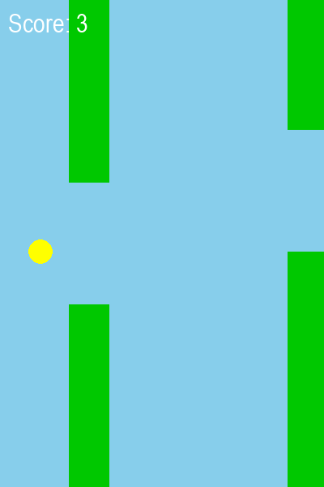

# Flappy Bird Clone

A small arcade game built with Python and Pygame. Keep the bird airborne, fly through randomized pipe gaps, and earn a point for each pipe you clear.



## Features

- Gravity and one-button flap controls.
- Randomized pipes and collision detection.
- Score tracking and instant restart after game over.
- All graphics drawn in code, with no image or audio assets required to play.

## Run locally

Requires Python 3.10 or newer and a desktop with a graphical display. Tested with Python 3.12 and Pygame 2.6.1 on Windows.

```sh
git clone https://github.com/br8nfroze/flappy-bird-clone.git
cd flappy-bird-clone
python -m venv .venv
```

Activate the environment on Windows PowerShell:

```powershell
.venv\Scripts\Activate.ps1
```

On macOS or Linux:

```sh
source .venv/bin/activate
```

Install the dependency and start the game:

```sh
python -m pip install -r requirements.txt
python flappy_bird.py
```

## Controls

| Action | Control |
| --- | --- |
| Flap | Space |
| Restart after game over | Space |
| Quit | Close the game window |

## Project structure

`flappy_bird.py` contains the game loop, bird physics, pipe generation, scoring, and rendering. `requirements.txt` pins the tested dependency. `assets/screenshot.png` shows a representative gameplay scene. `tests/` contains headless regression checks.

## Check the game

Run the tests without opening a game window:

```sh
python -m unittest discover -s tests -v
```

This is a personal learning project inspired by Flappy Bird.
